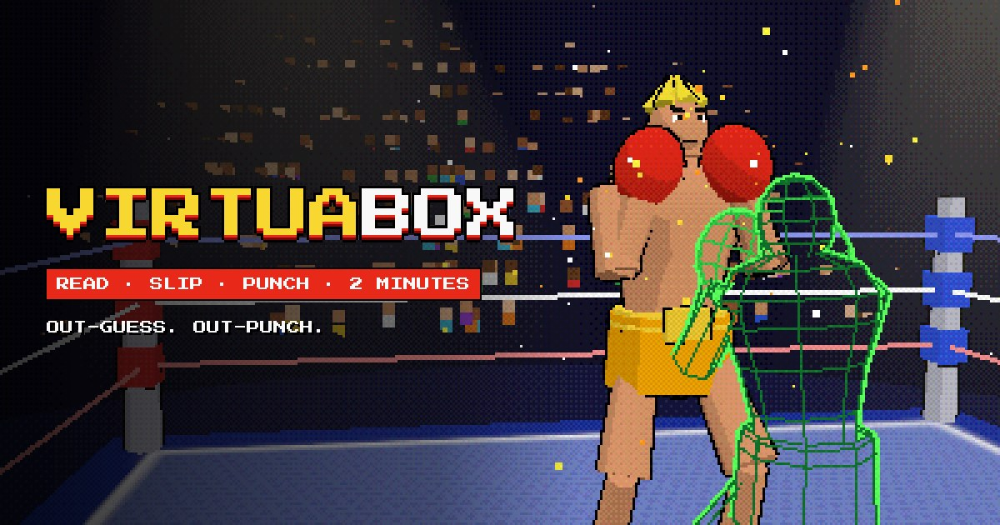

# VIRTUABOX

Up down all around. A two-minute, mobile-first boxing game with a classic
16-bit Nintendo look: a green wireframe boxer versus cel-shaded pixel
fighters in a 3D ring rendered at SNES resolution, a Punch-Out-style split
screen with a SNES controller underneath, and a turn-based read-and-react
fight loop.



## How it plays

Every exchange is two turns, each a single decision with instant payoff.

1. **THEIR TURN — read the tell.** The opponent winds up and the glove that's
   about to fire flashes `!`. Make one read before it lands:
   - hook from the left → **SLIP RIGHT**, hook from the right → **SLIP LEFT**
   - jab → **DUCK**
   - body blow → **BLOCK**

   A perfect read makes them whiff, earns a **★** and leaves them wide open.
   Blocking the wrong punch takes chip damage; reading wrong gets you tagged
   and costs a star.
2. **YOUR TURN — hit the openings.** They guard two of four targets (head or
   body, left or right). Punch an open target to land; each hit shifts their
   guard and shortens the next window, so you chain up to a 4-hit **FLURRY**.
   Hit a glove and your turn ends. After a perfect read they're wide open
   (**COUNTER!**); after you got tagged they tighten up to a single opening.
3. **★ SUPER.** Tap the star in the middle of the pad for an unblockable
   uppercut. Your stars drain into the glove one at a time as it charges
   (speed lines, golden aura, a rising sound), then a slow-motion uppercut
   lifts them off the canvas. Saving up pays: 1 star does 20 damage, 2 do 44,
   all 3 do 76.

KO all three fighters before the **2:00** clock runs out. Every bout uses a
**three-knockdown rule for both fighters**: empty a health bar to score a
knockdown, and the third knockdown is the KO. The referee steps in with a
one-second count and an animated count signal. Fighters rise at **six** after
their first fall (60% health) and **eight** after their second (40% health).
On the third fall the referee counts all the way to **ten** and waves it off.
Three markers under each health bar track falls in the current bout.

The match clock stops for counts, recoveries, KO celebrations and introductions;
pause also freezes the referee. Knockdown markers reset for each new opponent,
and KO bonuses and circuit progress are awarded only after the third fall.

New to it? Pick **TRAINING GYM** from the main menu. Coach Pops walks you
through the instruction booklet one move per page: slip, duck, block, read it,
punch, combo, counter and super, then the champs' tricks (feint, double attack,
mega uppercut, guard switch). Pages use plain sentences with pictures of the
buttons. Each page has a move table and a
live demo in the ring above it. Press **TRY IT** to drill that move with the
real controls until you pass. Progress is saved, and clearing every lesson
earns a graduation page that sends you straight into the fight.

| Fighter | Tells | Tricks |
| --- | --- | --- |
| PIXEL PETE | slow, honest | loves the jab; hints teach the reads |
| NOVA KID | fast | double attacks, feints that switch the flashing glove late |
| MEGAVOLT | lightning | feints, guards that shift mid-turn, and a MEGA UPPERCUT (slip it, never duck it) |

Everyone speeds up as they get hurt, and feinters feint more if you keep
reading too early.

Controls: the D-pad defends, the colored pad punches. You can also play on
the ring itself: swipe left/right/down/up to slip/duck/block, tap where you
want to punch, flick up for the super. Keyboard: arrows to defend, `Q` `W`
`A` `S` to punch, `Space` for the super, `Esc`/`P` to pause. Every menu works
with arrows + `Enter` (`Esc` backs out) as well as taps.

Menus also support `Tab` / `Shift+Tab` with a visible focus cursor. Keyboard
labels appear on the controller when you use keys; on touch devices the pad
stays uncluttered. Ring gestures belong to the turn in which they start, so a
canceled swipe or a finger held through a turn change cannot fire a stray punch.
The HUD distinguishes live time from a stopped clock, and attacks stop at zero.

Choose **MOTION: REDUCED** in the main or pause menu for steadier cameras and
reduced flashes and screen shake. The game follows your system preference until
you choose a setting, then remembers it alongside your sound preference.

When the match ends you get a score card PNG (with a frame captured from your
knockout, and a grid of every read and punch) to share through the native
share sheet, or to save/copy on desktop.

## The 16-bit look

- The 3D scene renders at roughly 232 rows (SNES territory) and is upscaled by a
  whole number with `image-rendering: pixelated`, so every pixel is square.
- A post pass quantizes to a small per-channel palette with a 4×4 Bayer ordered
  dither, so light shafts and gradients break into classic dither patterns.
- Opponents are cel-shaded (3-step toon ramp) with constant-width ink outlines.
  You are a see-through green wireframe with a bold outline, like the Super
  Punch-Out!! reference.
- Each opponent has a distinct face, build and kit: Pete's purple mohawk and
  checker shorts, Nova's headband and star motif, and Megavolt's gold crest,
  broad shoulders and lightning trunks. Gloves have thumbs and cuffs, boots
  have laces, and fighters animate back to their feet after a knockdown.
- The UI uses Press Start 2P, SNES menu windows, and Super Famicom colored face
  buttons for the punch pad.

## Screens and UI

The world circuit visits a different venue for each opponent:

| Bout | Venue | Setting |
| --- | --- | --- |
| Pixel Pete | Bit City Gym | A neighborhood boxing hall with warm industrial lighting |
| Nova Kid | Neon Bay Rooftop | A rooftop ring against a neon city skyline |
| Megavolt | Voltage Dome | A championship arena with banners and a lighting rig |

The title's attract mode cycles through the circuit, highlighting the featured
fighter in the roster. The training gym remains a separate practice venue.
Each venue has its own canvas, ropes, signs and lighting. Static scenery is
batched to keep draw calls low, and soft contact shadows anchor fighters to the
mat. Intro cameras establish the venue; fight and referee cameras stay steady.

It's laid out like a dual-screen handheld. The top screen is always the 3D
ring, and the bottom screen swaps between the controller and menu windows:

- **Title**: an original vector arcade crest with a raised glove, dimensional
  gold/cyan lettering and a stepped entrance sits over an attract-mode demo. PRESS
  START (with tonight's card) opens the main menu: FIGHT!, TRAINING GYM, SOUND, MOTION.
- **Tale of the tape**: before each bout, VS plates slide in over the ring.
  The bottom screen shows the opponent's portrait, hometown, record,
  SPEED/POWER/TRICKS meters, a coach's tip and the circuit ladder. Tap to skip.
- **Fight**: the controller takes over. The ring is framed red on their turn,
  green on yours and flashing yellow on a counter. The screen edges pulse red
  when you're low. The strip between the screens shows the circuit pips and a
  pause button.
- **Fight report**: the headline and score count up over the ring and your
  rank is stamped on. The bottom screen pops in the stat tiles and a
  read/punch log with a legend, plus SHARE / REMATCH / MENU.
- **Pause**: RESUME, RESTART (or BOOKLET in the gym), QUIT, SOUND, MOTION.

All of it shares one window style, one button style and one glove cursor.
Every transition is stepped like sprite animation: windows grow open from a
line, screens change behind a twelve-bar wipe, and dialog types out without
reflowing. Fighter portraits are rendered from the actual 3D models through
the same palette and dither pass, so the menu art always matches the ring.

## Run it

It's a static site with no build step. Serve the folder with any web server:

```sh
python3 -m http.server 8080
# or: npx serve .
```

Then open http://localhost:8080 (on a phone, use your machine's LAN IP).

## Layout

```
index.html              page shell: ring, HUD, controller deck, bottom-screen views, overlays, meta/OG tags
styles.css              mobile-first layout (portrait split, landscape side-by-side), UI kit, stepped animations
js/main.js              game flow: title/menus, bouts, their turn / your turn loop, training gym, results, pause
js/ui.js                UI kit: menus + glove cursor, bottom-screen views, wipes, typewriter, stamps, count-ups
js/lessons.js           training gym booklet: one lesson per move, diagrams, drills, coach feedback
js/rules.js             attacks, reads, guards, damage/score constants, opponent AI
js/boxer.js             procedural boxers (toon + ink outline, or green ghost wireframe), 2-bone IK, tells, guards, slips, punches, KOs
js/stage.js             three.js arena + training gym at ~232 rows, 16-bit palette + ordered-dither pass, pixel FX, camera shots, 3D portraits
js/venues.js            batched procedural venue scenery and venue palettes
js/audio.js             ElevenLabs samples + WebAudio synth fallback
js/share.js             1080×1352 pixel-art share card + share text
js/vendor/three.js      tree-shaken three.js r186 bundle (generated)
audio/                  generated SFX, announcer lines and soundtrack (mp3)
icons/, og.jpg          pixel-art favicon + PWA icons, social preview (generated)
manifest.webmanifest    installable PWA manifest
tools/                  asset/bundle generators
```

## Fight regression checks

The browser checks exercise real keyboard controls and the fight loop, including
both fighters' three knockdowns, counts, health recovery, pause/restart, lethal
super and chip damage, and KO scoring. They also play a full-health circuit,
verify venue changes and reject canceled gestures and punches after the bell.
Presentation checks cover saved motion settings, keyboard navigation and menu
fit at four phone/desktop sizes. They require Playwright and Chromium:

```sh
npm i --no-save playwright-core
CHROMIUM=/path/to/chrome node tools/test-fights.mjs
CHROMIUM=/path/to/chrome node tools/test-presentation.mjs
```

Set `SCREENSHOTS=/tmp/vb-polish` on the fight checks to save venue and referee
frames at each size. Presentation checks save their screenshots there by default.

## Regenerating assets

```sh
# three.js bundle (after adding new THREE.* symbols to js/)
npm i --no-save three@0.186.1 esbuild && node tools/build-vendor.mjs

# pixel icons (SVG + PNG) + og.jpg (renders the real 3D scene headlessly)
npm i --no-save playwright-core && node tools/render-assets.mjs

# SFX, announcer and music via ElevenLabs (delete a file to regenerate it)
ELEVENLABS_API_KEY=... node tools/gen-audio.mjs
```

Never commit API keys; `tools/gen-audio.mjs` only reads the key from the
environment.

The `og:image` tag uses a relative path. Some link unfurlers need an absolute
URL, so point it at the deployed `og.jpg` once the site has a home.

Debug query params: `?cam=y,dist,lookY,x,hfov` tunes the fight camera,
`?ts=0.2` slows time, `?dtcap=0.25` lets slow headless browsers keep pace,
`?autostart=1` jumps into a match, `?gym=1` opens the training gym.
